# Mixxx 2.7 alpha — fork con aspecto VirtualDJ, stems, IA y OSC

Este repositorio es un **fork personal** de [Mixxx](https://mixxx.org) **2.7.0-alpha**, hecho
sobre la rama `main` de [mixxxdj/mixxx](https://github.com/mixxxdj/mixxx) (commit base
`0fffd3d0d0`). Además de todo lo que trae upstream, lleva el trabajo de estas semanas:
**aspecto tipo VirtualDJ/Serato** en los skins QML, **generación de stems dentro de Mixxx**,
**asistente de IA para el AutoDJ**, panel **Track Advisor**, **servidor OSC** y una tanda de
arreglos de audio, de controlador y de teclado.

> [!WARNING]
> **Recursos gráficos:** no se ha copiado ni un solo fichero gráfico, logotipo ni fuente de
> VirtualDJ ni de Serato. El parecido es de *estilo* (superficies planas, color por deck,
> ondas monocromas, pads). Los iconos son **Font Awesome Free** (SIL OFL 1.1 / CC BY 4.0 /
> MIT) y la tipografía **Rajdhani** (SIL OFL 1.1): ambas se pueden redistribuir con
> atribución, y la atribución va incluida en `res/fonts/*.LICENSE.txt`.

---

## 1. Aspecto y skins

| Novedad | Cómo se ve |
| --- | --- |
| **Deck nuevo estilo VirtualDJ.** El deck de PulseDeck es ahora la composición de la skin experimental de upstream (plato grande con las filas de título y tiempo al lado, fila de transporte debajo del plato, controles de pitch en el borde exterior) con los adornos del estilo VDJ encima. | 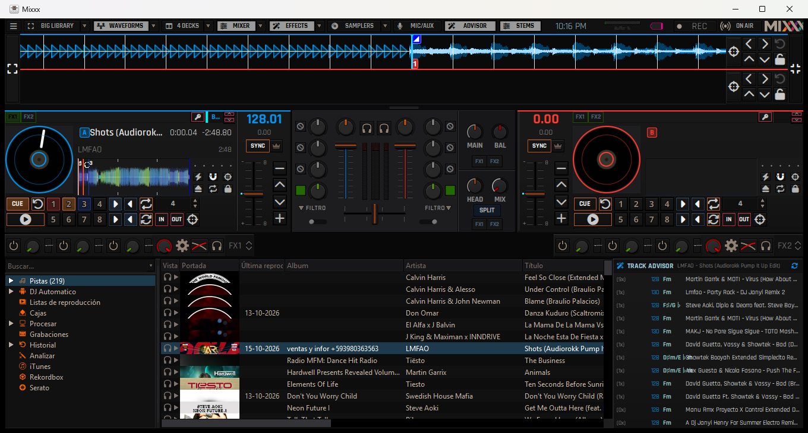 |
| **Color por deck** (A azul `#0096f3`, B rojo `#ff3b30`, tomados de la paleta de VirtualDJ 8): tira de acento en el borde superior del deck, **onda y overview en tonos del color del deck**, BPM y tonalidad en color, insignia cuadrada A/B/C/D y **espejado de los decks B/D** (los controles se van al borde exterior, como en VDJ). Los esquemas Classic y PaleMoon conservan su paleta original. | 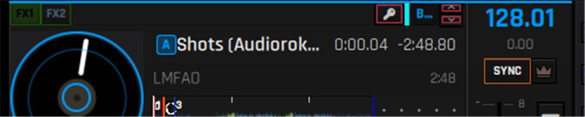 |
| **Botón SYNC con texto.** Los botones escriben la función en vez de dibujar un glifo (`SYNC`, `CUE`, `IN`, `OUT`), como VirtualDJ. | 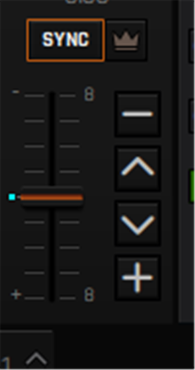 |
| **Iconos Font Awesome Free** en todos los controles del deck (play, cue, loop, reloop, beatjump, slip, quantize, keylock, eject, sampler, mic...) y **tipografía Rajdhani** en los tres skins y también en los widgets nativos (biblioteca, menús y diálogos). | 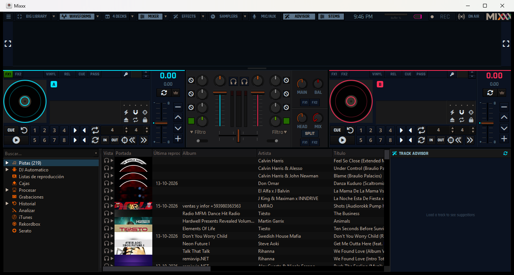 |
| **Arreglo de los controles de tonalidad.** El bloque de la llave (sync de tonalidad, nota y flechas de pitch) vivía en un hueco elástico y, cuando la fila no daba de sí, quedaba montado encima de las filas de título. Ahora tiene ancho fijo y los controles de vinilo tienen fila propia (o se ocultan si no caben). | 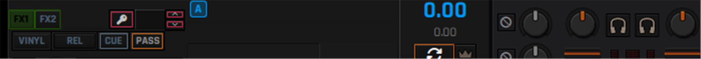 |
| **Tema oscuro de verdad** en menús y diálogos (estilo Fusion + paleta propia), y **biblioteca** afinada por hoja de estilo (fondo `#111111`, selección azulada). | 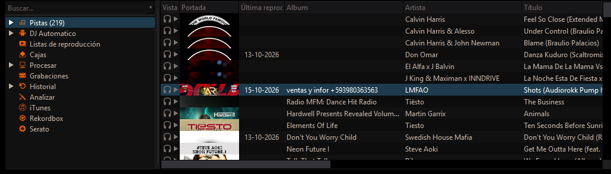 |
| **Efectos en la banda** con los racks a la vista y el rack de micro/aux en medio, sin duplicar los knobs que ya están junto al plato. | 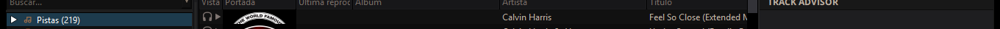 |

Los tres skins QML (`PulseDeck`, `NeonDeck` y `LateNightQML`, la experimental de upstream)
llevan las mismas funciones y arreglos, cada uno con su aspecto propio.

## 2. Generación de stems dentro de Mixxx

Mixxx ya sabía **reproducir** stems; este fork además los **genera**:

- **Worker externo** `res/stems/stems_worker.py` (+ `stem_mp4.py`) que separa con **Demucs
  (ONNX Runtime, sin PyTorch)** y escribe un contenedor Native Instruments `.stem.mp4`
  (la mezcla y los cuatro stems, con el manifiesto en `moov/udta/stem`).
- **Cola de trabajos** dentro de Mixxx: un trabajo a la vez, pospuesto mientras hay música
  sonando, con progreso y cancelación.
- **Asistente de entorno**: detecta si hay GPU y avisa de lo que tardará, antes de empezar.
  Con una RTX 3060 mide **~10× el tiempo real** (20 s por cada 4 minutos de canción) y con CPU
  **~2,4×** (unos 100 s por esos mismos 4 minutos).
- **Interfaz**: pestaña *Stem Generation* en Preferencias, menú contextual de la biblioteca
  (*Stems → Generate stems*) y columna de stems en la lista de pistas.

| Página de Preferencias | Aviso de entorno (GPU/CPU) |
| --- | --- |
| 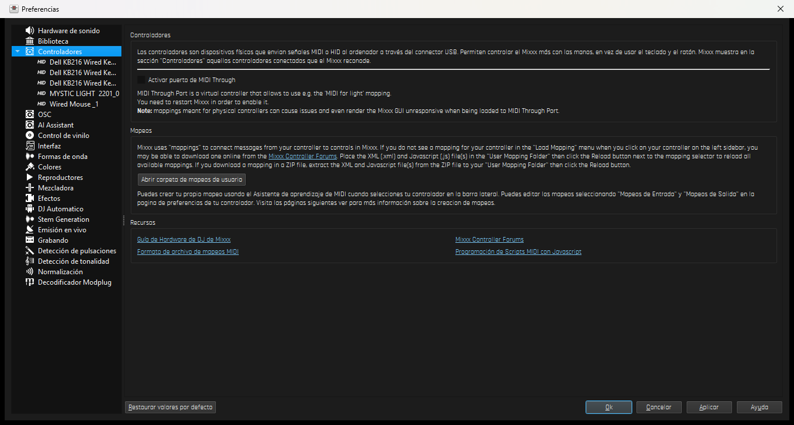 | 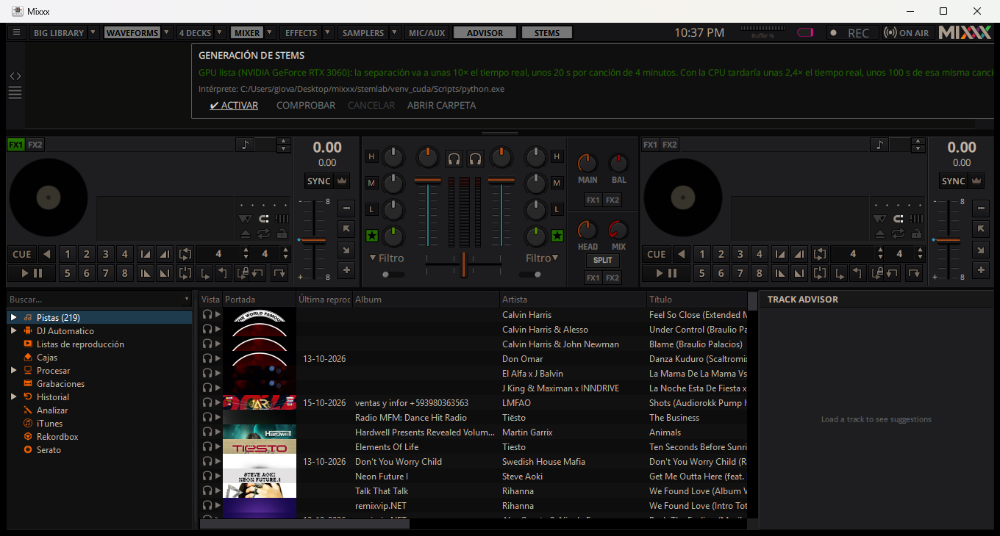 |

## 3. Asistente de IA para el AutoDJ

Un asistente que **decide qué pista suena después** usando un servicio compatible con OpenAI
(DeepSeek por defecto): se le manda la lista de candidatas y la instrucción en lenguaje
natural («sube la energía poco a poco, nada de vocales en el drop»), y devuelve el orden. Las
transiciones las sigue haciendo el AutoDJ de Mixxx, con **selección armónica** (círculo de
quintas + tolerancia de BPM, con ventanas de tempo mitad y doble) y la pista se carga en el deck
que no guía la lista, para no romperla.

| Proveedor y credenciales | Panel Track Advisor |
| --- | --- |
| 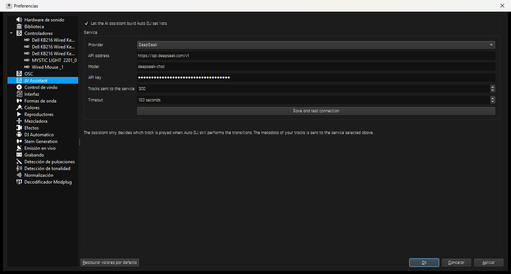 | 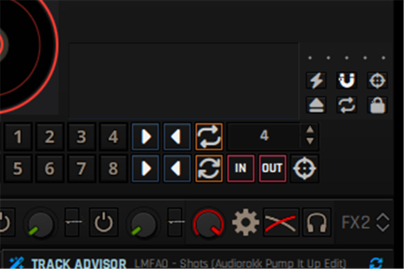 |

El panel **Track Advisor** (botón *ADVISOR* de la barra, *Ctrl+7*) lista las pistas compatibles
con la que está sonando —misma tonalidad o vecinas y BPM a menos del 6 %— con su clave y sus
reproducciones: un clic en una fila la carga en el otro deck.

## 4. Servidor OSC

Mixxx escucha OSC y publica su estado, configurable en Preferencias → *OSC* (puerto de entrada
`11119`, de salida `11118`, direcciones tipo `/Channel1/play` o `/Master/crossfader`). Sirve para
controlar Mixxx desde otra máquina o desde un móvil, y para automatizar pruebas sin tocar la
interfaz.

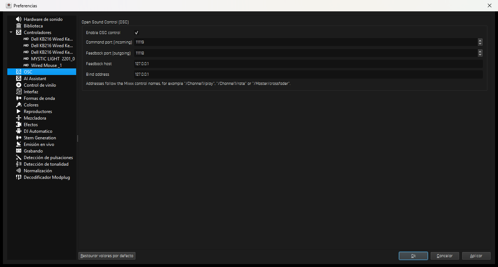

## 5. Audio, controladores y teclado

| Arreglo | Detalle |
| --- | --- |
| **Ajustes de dispositivos de audio** | Página de hardware de sonido con **botón para consultar los aparatos** disponibles y aviso cuando Mixxx sustituye el dispositivo de salida; cuando la mesa se desconecta cae al dispositivo del sistema en vez de quedarse sin sonido. |
| **WASAPI** | El silencio con WASAPI no era del motor: era el dispositivo elegido (abría el de la mesa desconectada). Se dejó documentado y con la corrección de *sample rate* (`44100 → 48000` cuando el dispositivo no puede). |
| **Controladores** | Mapeo del **Numark Mixtrack Pro II** corregido (CC de faders y sensor de tacto), mapeo del Mixtrack Pro original actualizado a los controles de Mixxx 2.x (`[Flanger]` ya no existe) y un `abort()` del script que cerraba Mixxx al usar el plato. |
| **Teclado** | Los atajos ya no se disparan al escribir en los paneles QML (AutoDJ, filtros de la biblioteca) y la barra espaciadora no activa *BIG LIBRARY* mientras se escribe. |

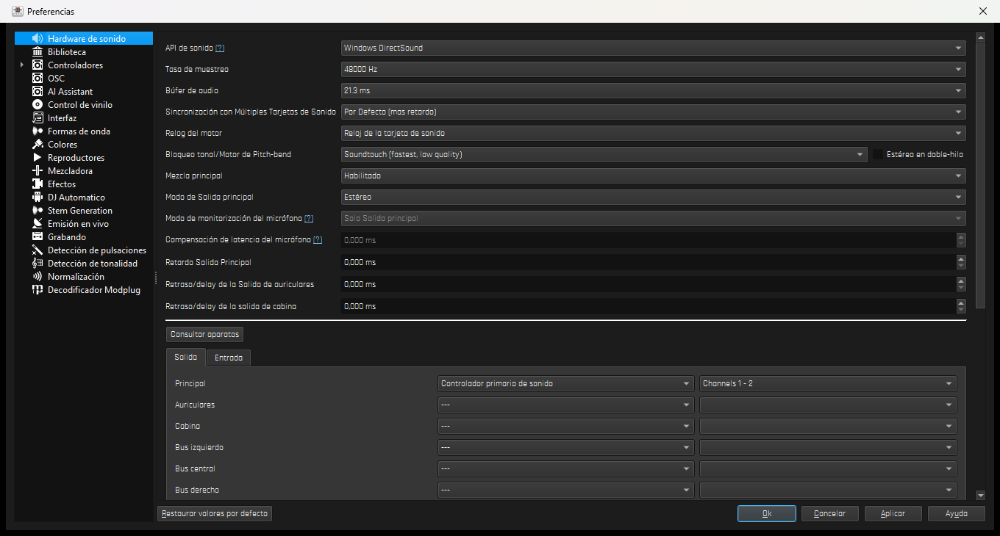

## 6. Cómo compilar

### Windows → instalador `.msi`

```cmd
build_windows_release.cmd
```

Localiza MSVC con `vswhere`, configura `build\x64__legacy` con CMake + Ninja, compila y empaqueta
con `cpack -G WIX`. **No interrumpir** la compilación (una compilación cortada deja la base de
dependencias de Ninja a medias y provoca cierres aleatorios al arrancar). Las dependencias van en
caché dentro de `buildenv\`.

### Linux → paquete `.deb` (desde Windows, dentro de WSL)

```bash
wsl -d Ubuntu-24.04 -u root bash wsl_rebuild_deb.sh mixxx-mi-version-amd64.deb
```

Sincroniza el árbol a `/home/mixxx/mixxx` conservando su `build/` (la compilación es
incremental), normaliza los permisos que NTFS no guarda, compila como usuario `mixxx` y copia el
`.deb` a `dist\`. El paquete lleva las dependencias de FFmpeg con la alternativa `-extra` para que
Linux Mint no desinstale `mint-meta-codecs`, y las fuentes e iconos del skin.

### Probar los cambios de skin sin compilar

Las skins y el QML son datos: se pueden probar contra el binario ya compilado.

```cmd
build\x64__legacy\mixxx.exe --resource-path "C:\ruta\al\repo\res"
```

## 7. Paquetes generados

En `dist\` quedan los últimos paquetes construidos (`mixxx-2026-10-15-deck-vdj-amd64.msi` y
`mixxx-2026-10-15-deck-vdj-amd64.deb`), pero **no se versionan**: se regeneran con los dos
comandos de arriba.

## 8. Detalle de los cambios y estado

El desarrollo está documentado en [`CAMBIOS.md`](CAMBIOS.md), sección por sección: qué se cambió,
por qué, qué se descartó y qué queda pendiente (renombrar la paleta interna, afinar más la
biblioteca, causa raíz de WASAPI, etc.).

## Créditos y licencias

- **Mixxx** y este fork: **GPL v2** (ver [`COPYING`](COPYING)). El proyecto original es de la
  [comunidad de Mixxx](https://github.com/mixxxdj/mixxx).
- **Font Awesome Free 6.7.2** — fuentes SIL OFL 1.1, iconos CC BY 4.0, código MIT
  (`res/fonts/FontAwesomeFree.LICENSE.txt`).
- **Rajdhani** — SIL OFL 1.1 (`res/fonts/Rajdhani.LICENSE.txt`).
- **htdemucs** (modelo de separación) bajo licencia MIT, ejecutado con **ONNX Runtime** desde
  el worker de `res/stems/`.
