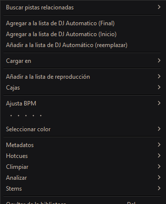
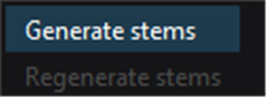
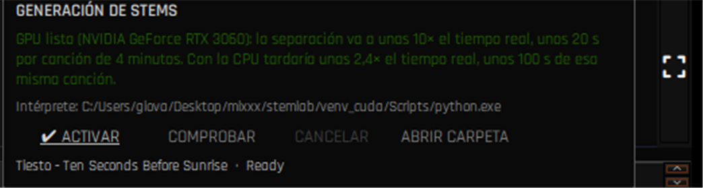
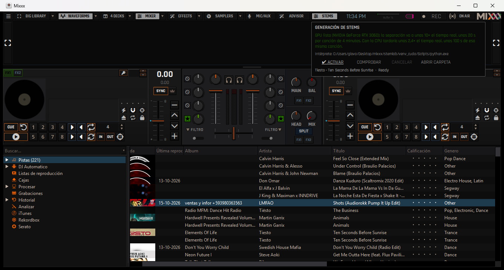
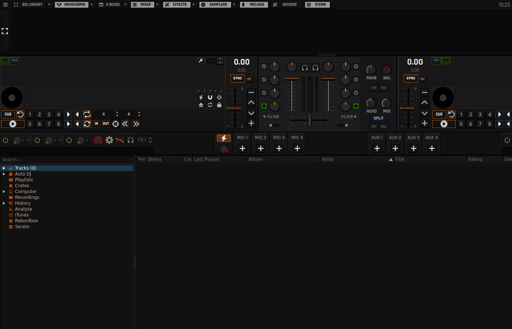

# Mixxx 2.7 alpha — fork with a VirtualDJ look, stems, AI and OSC

This repository is a **personal fork** of [Mixxx](https://mixxx.org) **2.7.0-alpha**, based on the
`main` branch of [mixxxdj/mixxx](https://github.com/mixxxdj/mixxx) (base commit `0fffd3d0d0`). On
top of everything upstream ships, it carries the work of the last few weeks: a **VirtualDJ/Serato
style look** in the QML skins, **stem generation inside Mixxx** (Windows and Linux, CPU or GPU),
an **AI assistant for AutoDJ**, a **Track Advisor** panel, an **OSC server** and a batch of audio,
controller and keyboard fixes.

> [!WARNING]
> **Graphics assets:** not a single graphic file, logo or font has been copied from VirtualDJ or
> Serato. The resemblance is of *style* only (flat surfaces, per-deck colour, monochrome
> waveforms, pads). The icons are **Font Awesome Free** (SIL OFL 1.1 / CC BY 4.0 / MIT) and the
> type is **Rajdhani** (SIL OFL 1.1): both can be redistributed with attribution, and the
> attribution ships in `res/fonts/*.LICENSE.txt`.

---

## 1. Look and skins

| New | How it looks |
| --- | --- |
| **New VirtualDJ-style deck.** The PulseDeck deck is the composition of upstream's experimental skin (large platter with the title and time rows beside it, transport row under the platter, pitch controls on the outer edge) with the VDJ ornaments on top. |  |
| **Colour per deck** (A blue `#0096f3`, B red `#ff3b30`, taken from the VirtualDJ 8 palette): accent strip on the top edge of the deck, **waveform and overview in the deck colour**, BPM and key in colour, square A/B/C/D badge and **mirrored B/D decks** (controls move to the outer edge, as in VDJ). The Classic and PaleMoon schemes keep their original palette. |  |
| **SYNC button with text.** Buttons spell out their function instead of drawing a glyph (`SYNC`, `CUE`, `IN`, `OUT`), like VirtualDJ. |  |
| **Font Awesome Free icons** on every deck control (play, cue, loop, reloop, beatjump, slip, quantize, keylock, eject, sampler, mic...) and **Rajdhani type** in the three skins and in the native widgets (library, menus and dialogs). |  |
| **Key controls fix.** The key block (key sync, note and pitch arrows) lived in a stretchy slot and, when the row ran out of room, ended up drawn on top of the title rows. It now has a fixed width and the vinyl controls get a row of their own (or hide when they do not fit). |  |
| **A genuinely dark theme** in menus and dialogs (Fusion style plus a palette of its own), and a **library** tuned through a style sheet (`#111111` background, bluish selection). |  |
| **Effects in the band** with the racks in sight and the mic/aux rack in the middle, without duplicating the knobs that already sit next to the platter. |  |

The three QML skins (`PulseDeck`, `NeonDeck` and `LateNightQML`, upstream's experimental one)
carry the same features and fixes, each with a look of its own.

## 2. Stem generation inside Mixxx

Mixxx already knew how to **play** stems; this fork also **generates** them:

- **External worker** `res/stems/stems_worker.py` (plus `stem_mp4.py`) that separates with **Demucs
  (ONNX Runtime, no PyTorch)** and writes a Native Instruments `.stem.mp4` container (the mix and
  the four stems, with the manifest in `moov/udta/stem`).
- **Job queue** inside Mixxx: one job at a time, postponed while music is playing, with progress
  and cancellation.
- **Environment assistant**: detects whether there is a GPU and tells you how long it will take
  before starting. On an RTX 3060 it measures **~10x real time** (20 s per 4 minutes of music) and
  **~2.4x** on CPU (about 100 s for those same 4 minutes).
- **Interface**: *Stem Generation* page in Preferences, library context menu
  (*Stems -> Generate stems*) and a stems column in the track list.

| Preferences page | Environment notice (GPU/CPU) |
| --- | --- |
|  |  |

From the library: select a track, *right click -> Stems -> Generate stems*.

| Library menu | Generate entry |
| --- | --- |
|  |  |

The toolbar panel (*STEMS*) shows the detected environment, the switch for the feature and the
**job queue**:

| Panel in detail | STEMS tab next to the library |
| --- | --- |
|  |  |

### The engine is installed from the Preferences

Mixxx does **not** ship the separation engine inside: it is several hundred MB (ONNX Runtime, the
Python wheels and the models), so it is downloaded separately and installed into a folder of its
own, without touching anything in the system. It is done from **Preferences -> Stems -> Engine**,
with progress and a cancel button:

| Variant | What it downloads | For whom |
| --- | --- | --- |
| **CPU** | self-contained Python interpreter, the wheels for the platform and the models | any machine |
| **GPU (CUDA)** | the same, plus ONNX Runtime with CUDA and the NVIDIA wheels | machines with an NVIDIA GPU |

Measured on an RTX 3060: **~10x real time** (20 s per 4 minutes of music) against **~2.4x** on CPU.
The engine brings **its own `ffmpeg`**, so there is nothing to install on the system: no Python, no
pip, no compiler, nothing on the PATH. It can be removed from that same panel. On Linux a `tar.gz`
is unpacked and on Windows a ZIP, with a reader of its own in C++ that honours permissions and
symlinks and can be cancelled halfway.

## 3. AI assistant for AutoDJ

An assistant that **decides which track plays next** using an OpenAI-compatible service (DeepSeek
by default): it is given the list of candidates and the instruction in natural language ("raise the
energy little by little, no vocals in the drop"), and it returns the order. The transitions are
still done by Mixxx's AutoDJ, with **harmonic selection** (circle of fifths plus a BPM tolerance,
including half and double tempo windows) and the track is loaded into the deck that is not leading
the list, so the list is not broken.

| Provider and credentials | Track Advisor panel |
| --- | --- |
|  |  |

The **Track Advisor** panel (*ADVISOR* button in the toolbar, *Ctrl+7*) lists the tracks compatible
with the one playing —same key or neighbouring ones and BPM within 6%— with their key and their
play counts: one click on a row loads it into the other deck. The screenshot above shows it with no
track loaded ("Load a track to see suggestions").

## 4. OSC server

Mixxx listens to OSC and publishes its state, configurable in Preferences -> *OSC* (input port
`11119`, output `11118`, addresses such as `/Channel1/play` or `/Master/crossfader`). It is useful
to control Mixxx from another machine or a phone, and to automate tests without touching the
interface.


## 5. Audio, controllers and keyboard

| Fix | Detail |
| --- | --- |
| **Audio device settings** | Sound hardware page with a **button to query the available devices** and a notice when Mixxx replaces the output device; when the mixer is unplugged it falls back to the system device instead of going silent. |
| **WASAPI** | The silence with WASAPI was not the engine's fault: it was the chosen device (it opened the unplugged mixer). It is documented, with the *sample rate* fix (`44100 -> 48000` when the device cannot do it). |
| **Controllers** | **Numark Mixtrack Pro II** mapping fixed (fader CCs and touch sensor), original Mixtrack Pro mapping updated to the Mixxx 2.x controls (`[Flanger]` no longer exists) and an `abort()` in the script that closed Mixxx when using the platter. |
| **Keyboard** | Shortcuts no longer fire while typing in the QML panels (AutoDJ, library filters) and the space bar does not toggle *BIG LIBRARY* while typing. |


## 6. How to build

### Windows -> `.msi` installer

```cmd
build_windows_release.cmd
```

It locates MSVC with `vswhere`, configures `build\x64__legacy` with CMake + Ninja, builds and packs
with `cpack -G WIX`. **Do not interrupt** the build (an interrupted build leaves Ninja's dependency
database half written and causes random crashes at startup). The dependencies are cached inside
`buildenv\`.

### Linux -> `.deb` package (from Windows, inside WSL)

```bash
wsl -d Ubuntu-24.04 -u root bash wsl_rebuild_deb.sh mixxx-my-version-amd64.deb
```

It syncs the tree to `/home/mixxx/mixxx` keeping its `build/` (the build is incremental),
normalises the permissions NTFS does not keep, builds as the `mixxx` user and copies the `.deb` to
`dist\`. The package carries the FFmpeg dependencies with the `-extra` alternative so Linux Mint
does not remove `mint-meta-codecs`, plus the fonts and icons of the skin.

### Trying skin changes without building

Skins and QML are data: they can be tried against the already built binary.

```cmd
build\x64__legacy\mixxx.exe --resource-path "C:\path\to\repo\res"
```

## 7. Downloads and generated packages

The installers of the last batch are published together on the fork's **releases** page:
**[`v2.7.0-alpha-2026-10-16`](https://github.com/kenmaster37/mixxx/releases/tag/v2.7.0-alpha-2026-10-16)**

| Package | For |
| --- | --- |
| [`mixxx-2026-10-16-stem-engine-amd64.msi`](https://github.com/kenmaster37/mixxx/releases/download/v2.7.0-alpha-2026-10-16/mixxx-2026-10-16-stem-engine-amd64.msi) | **Windows** 10/11 x64 |
| [`mixxx-2026-10-16-stem-engine-amd64.deb`](https://github.com/kenmaster37/mixxx/releases/download/v2.7.0-alpha-2026-10-16/mixxx-2026-10-16-stem-engine-amd64.deb) | **Linux** amd64 (Ubuntu 24.04 / Mint) |

To check that what you downloaded is what was published:

```
sha256  mixxx-2026-10-16-stem-engine-amd64.msi  87647f50ad7a68ea7576a525aae13e27aaddde97193a1cff089521745db86074
sha256  mixxx-2026-10-16-stem-engine-amd64.deb  607ce430b128e958dde77b3118e94d807692972e29dc6f3c8ecf39a5077e31bc
```

The `.deb` was rebuilt on the morning of the 17th with the **window icon** and the launcher
pointing at the icon file; the `.msi` is the one from the night before because those fixes are
Linux-only.

The previous batch is still available at
[`v2.7.0-alpha-2026-10-15`](https://github.com/kenmaster37/mixxx/releases/tag/v2.7.0-alpha-2026-10-15).

There are copies in `dist\` too, but they are **not versioned**: they are regenerated with the two
commands above.

## 8. The 16 October batch: the stem engine on Linux

This batch is mostly about the **stem engine**, which until now only installed on Windows, plus a
handful of bugs found while testing it on a Linux Mint machine and on a laptop without a GPU.

| New | How it looks |
| --- | --- |
| **The stem engine now installs on Linux.** The Linux manifest (`res/stems/engine-linux.json`) fetches a self-contained Python interpreter and the `manylinux` wheels, unpacks them with a `tar.gz` reader of its own (`src/stems/tararchive.cpp`, with symlinks, permissions and cancellation) and grants execute permission to its `ffmpeg`. With a **GPU**: ONNX Runtime with CUDA and `LD_LIBRARY_PATH` pointing at the NVIDIA wheels. Measured on an RTX 3060: **12.8 s** per 12 s of audio, against **19.0 s** on CPU. |  |
| **The `.deb` can be found, opened and removed.** The test package installs under its own prefix and the `postinst` creates the launcher `/usr/local/bin/mixxx-stem-engine`, the menu entry and the themed icons; the `postrm` leaves everything clean. It also installs the project images (`res/images`), so relative references such as `../images/keywheel/keywheel.svg` resolve. | — |
| **MIC/AUX and the effect slots came up empty on Linux.** The QML of those units carried `pragma ComponentBehavior: Bound` while handing its `Component` blocks to a `Loader`, which Qt forbids: the item was never created and the box stayed empty. The pragma is gone from the three QML skins; verified that the `outside its creation context` warnings disappear and that `MIC 1..4` and `AUX 1..4` are drawn. |  |
| **Library and side panel sharp at fractional scaling.** The library is a widget tree painted offscreen; the pixmap was created one pixel per logical pixel and the engine scaled it up. It is now created at device resolution and repainted when moving to another screen. |  |
| **The waveform flicker.** The log filled with `VisualPlayPosition::calcOffsetAtNextVSync ... outdated position request`: the renderer asked for the position of the next frame and it had already gone by, so the waveform froze for a frame and jumped. On Linux `QSG_RENDER_LOOP=basic` is now set before the application is created (and can be overridden with the environment variable). |  |
| **The `.stem.mp4` container failed at the end.** The worker asked for `ffprobe`, which the engine does not ship: the tag is read with `ffmpeg` itself (`-f ffmetadata`) and the encoder is checked before separating. |  |
| **Menu fixes.** The `Mixxx.Application` proxy does not resolve in some environments and the menu shortcuts were armed anyway: they swallowed the space bar while typing. Now, when there is no focus information, no shortcut is armed. | — |

With this, **a library scan still shows the `.stem.mp4` as a track of its own**: that is the notice
that the conversion happened. Hiding it when its original sits next to it is left for a later
version.

## 9. Details of the changes and status

Development is documented in [`CAMBIOS.md`](CAMBIOS.md), section by section: what was
changed, why, what was discarded and what is pending.

## Credits and licences

- **Mixxx** and this fork: **GPL v2** (see [`COPYING`](COPYING)). The original project belongs to
  the [Mixxx community](https://github.com/mixxxdj/mixxx).
- **Font Awesome Free 6.7.2** — SIL OFL 1.1 fonts, CC BY 4.0 icons, MIT code.
- **Rajdhani** — SIL OFL 1.1.
